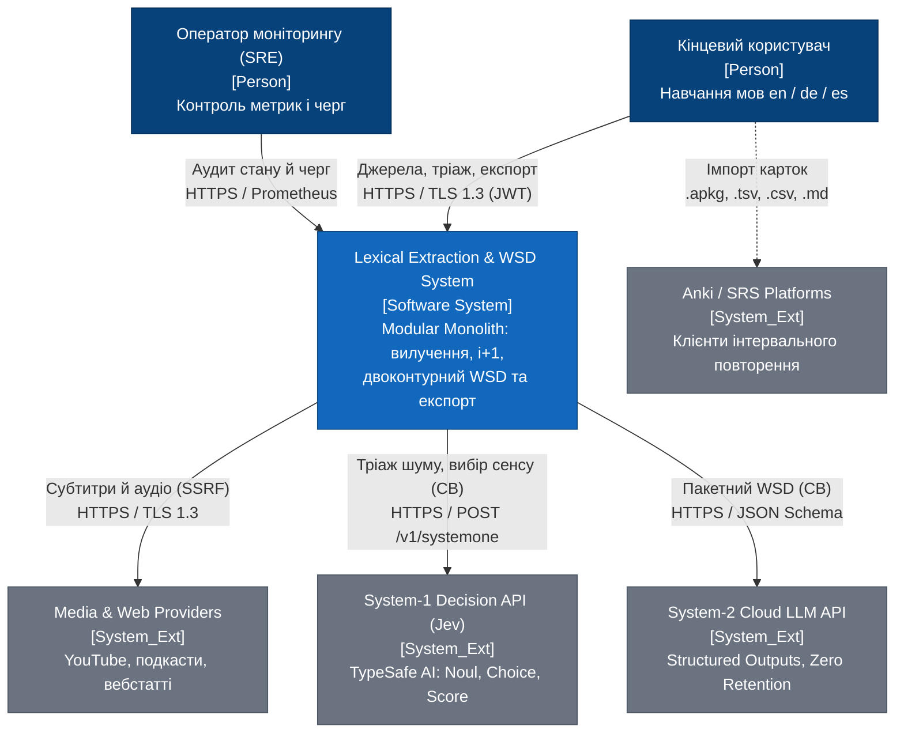
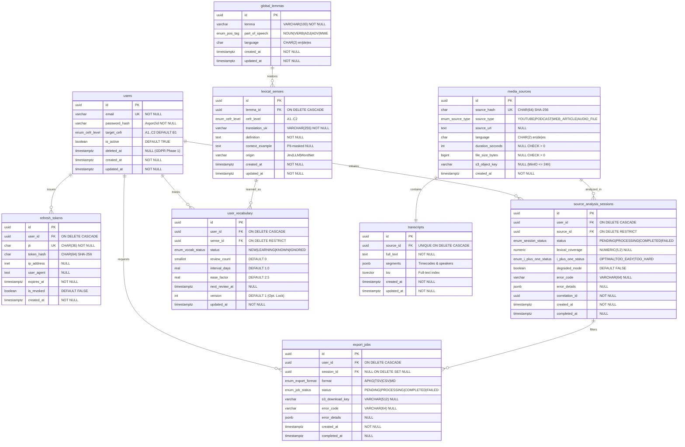
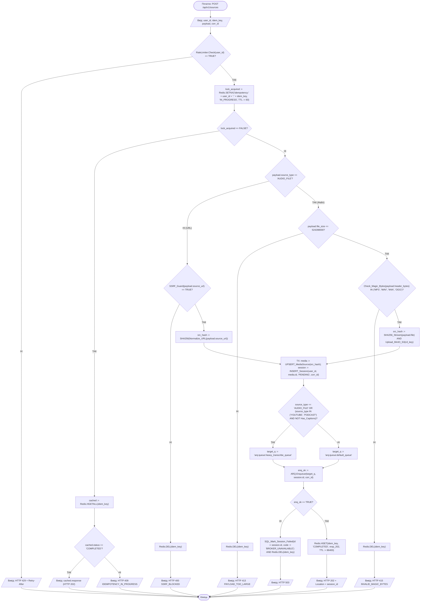
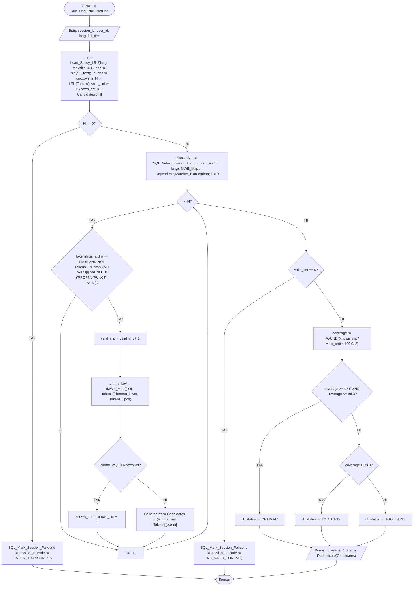
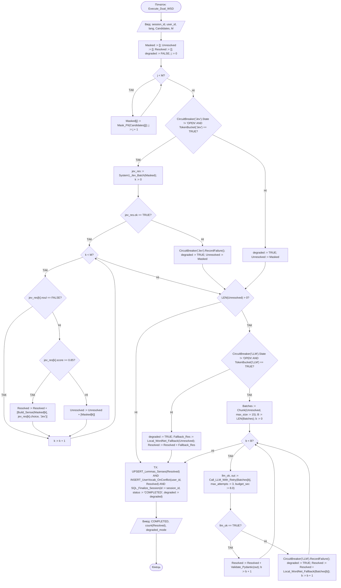

# РОЗДІЛ 2. АРХІТЕКТУРНЕ ПРОЄКТУВАННЯ, МОДЕЛЮВАННЯ ДАНИХ ТА АЛГОРИТМІЗАЦІЯ NLP/AI-КОНВЕЄРА

> **Статус документа:** Завершено підрозділи `2.1–2.7` (модель `C4` рівнів 1–3, `ADR-001`, реляційна схема `PostgreSQL 16` і `Redis 7`, контракт [`OpenAPI 3.0.3`](./api/openapi.yaml), алгоритмізація 3 критичних вузлів та інтеграційний аудит консистентності; наскрізне трасування до [`SRS`](./srs.md)).

---

## 2.1. Контекстне та контейнерне моделювання системи (C4 Levels 1–2)

Проєктування архітектури виконано за методологією **C4 Model** Саймона Брауна з використанням підходу *Diagrams-as-Code* (`Mermaid.js`) на основі затвердженого контракту вимог [`SRS`](./srs.md) та архітектурного рішення [`ADR-001`](./adr/0001-choice-of-technology.md).

<a id="diagram-level1"></a>
#### Діаграма C4 Level 1 — System Context Diagram



##### Технічний опис вузлів, акторів та протоколів рівня System Context
- **Кінцевий користувач:** взаємодіє із системою за протоколом `HTTPS / TLS 1.3` (`JWT Bearer`), реалізуючи сценарії інгестії ([`SRS-FUN-01`](./srs.md#srs-fun-01), [`SRS-FUN-02`](./srs.md#srs-fun-02)), тріажу та експорту колод ([`SRS-FUN-14`](./srs.md#srs-fun-14)).
- **Оператор моніторингу (`SRE`):** отримує доступ до зібраних метрик і структурованих журналів (`X-Correlation-ID`), реалізуючи вимоги спостережуваності [`SRS-NFR-OBS-01`](./srs.md#srs-nfr-obs-01) та контролю збоїв [`SRS-FUN-13`](./srs.md#srs-fun-13).
- **`Media & Web Providers`:** зовнішні веб- і медіаджерела, звернення до яких виконується через `HTTPS / TLS 1.3` із перевіркою IP-діапазонів (`SSRF Guard`, [`SRS-FUN-01`](./srs.md#srs-fun-01), [`SRS-NFR-SEC-02`](./srs.md#srs-nfr-sec-02)).
- **`System-1 Decision API (Jev)`:** зовнішня хмарна модель прийняття рішень (`TypeSafe AI`, `POST /v1/systemone`, клієнт `typesafe-sdk`), яка без генерації тексту оцінює стан через типізовані примітиви `Noul` (фільтрація артефактів субтитрів), `Choice` (вибір семантичного сенсу й найкращого речення) та `Score` за `70–500 мс` із маскуванням `PII` і захистом `Circuit Breaker` ([`SRS-FUN-10`](./srs.md#srs-fun-10), [`SRS-NFR-REL-01`](./srs.md#srs-nfr-rel-01)).
- **`System-2 Cloud LLM API`:** зовнішній генеративний провайдер пакетної дезамбігуації та перекладу нових термінів через `HTTPS / JSON Schema` із маскуванням `PII` ([`SRS-FUN-11`](./srs.md#srs-fun-11)) і захистом `Circuit Breaker` ([`SRS-NFR-REL-01`](./srs.md#srs-nfr-rel-01)).
- **`Anki / SRS Platforms`:** зовнішні автономні клієнти, у які користувач імпортує сформовані пакети `.apkg`, `.tsv`, `.csv` та `.md` ([`SRS-FUN-14`](./srs.md#srs-fun-14)).

---

<a id="diagram-level2"></a>
#### Діаграма C4 Level 2 — Container Diagram

```mermaid
flowchart TB
    classDef person fill:#08427B,stroke:#052E56,color:#FFFFFF
    classDef container fill:#2563EB,stroke:#1D4ED8,color:#FFFFFF
    classDef db fill:#1E40AF,stroke:#1E3A8A,color:#FFFFFF
    classDef ext fill:#6B7280,stroke:#4B5563,color:#FFFFFF

    User["Кінцевий користувач<br/>[Person]"]:::person
    SRE["Оператор моніторингу (SRE)<br/>[Person]"]:::person

    subgraph Boundary["Lexical Extraction & WSD Platform (Docker Compose)"]
        direction TB
        Proxy["Reverse Proxy<br/>[Nginx 1.25 Alpine]<br/>TLS 1.3, 500 MB, Correlation-ID"]:::container
        Prom["Prometheus<br/>[Container: TSDB]<br/>Метрики кожні 15 с"]:::container
        API["FastAPI Backend API<br/>[Python 3.12, FastAPI, Pydantic v2]<br/>JWT, MIME, SSRF, експорт"]:::container
        Redis(["Redis 7 Broker & Cache<br/>[ContainerQueue]<br/>Черги ARQ, DLQ, Token Bucket"]):::db
        NLP["NLP Background Worker<br/>[ARQ, spaCy, typesafe-sdk, HTTPX]<br/>default_queue, <= 512 MiB"]:::container
        ASR["ASR Background Worker<br/>[ARQ, faster-whisper INT8]<br/>heavy_queue, <= 2.0 GiB"]:::container
        PG[("PostgreSQL 16<br/>[ContainerDb]<br/>Лексика, сесії, користувачі")]:::db
        MinIO[("MinIO S3 Storage<br/>[ContainerDb]<br/>Транзитні медіа <= 24 год")]:::db
    end

    MediaExt["Media & Web Providers<br/>[System_Ext]"]:::ext
    JevExt["System-1 Jev API<br/>[TypeSafe AI / System_Ext]"]:::ext
    LLMExt["System-2 Cloud LLM API<br/>[System_Ext]"]:::ext

    User -->|"Запити й файли <= 500 MB<br/>HTTPS / TLS 1.3"| Proxy
    SRE -->|"Метрики<br/>HTTPS / Basic Auth"| Proxy

    Proxy -->|"API-трафік<br/>HTTP / TCP 8000"| API
    Proxy -->|"Дашборд<br/>HTTP / TCP 9090"| Prom
    Prom -.->|"Збір /metrics<br/>HTTP / TCP 8000"| API

    API -->|"Задачі, кеш, JTI<br/>RESP3 / TCP 6379"| Redis
    API -->|"CRUD, SHA-256<br/>AsyncPG / TCP 5432"| PG
    API -->|"Запис аудіо<br/>S3 REST / HTTP 9000"| MinIO

    NLP -->|"BLPOP / DLQ<br/>RESP3 / TCP 6379"| Redis
    ASR -->|"BLPOP / DLQ<br/>RESP3 / TCP 6379"| Redis

    NLP -->|"Леми, сенси, GDPR<br/>AsyncPG / TCP 5432"| PG
    ASR -->|"Транскрипти<br/>AsyncPG / TCP 5432"| PG
    ASR -->|"Читання аудіо<br/>S3 REST / HTTP 9000"| MinIO

    NLP -->|"Вебстатті (SSRF)<br/>HTTPS / TLS 1.3"| MediaExt
    ASR -->|"Медіа й субтитри<br/>HTTPS / TLS 1.3"| MediaExt
    NLP -->|"Noul / Choice / Score<br/>HTTPS / POST /v1/systemone"| JevExt
    NLP -->|"Пакетний WSD<br/>HTTPS / JSON Schema"| LLMExt

    style Boundary fill:transparent,stroke:#64748B,stroke-dasharray: 5 5
```



##### Технічний опис контейнерів та наскрізне трасування до вимог SRS і ADR
1. **`Reverse Proxy` (`Nginx 1.25`):** забезпечує термінацію `HTTPS / TLS 1.3`, обмеження максимального розміру тіла запиту `500 MB`, захист від повільних клієнтів і генерацію наскрізного ідентифікатора `X-Correlation-ID` ([`SRS-NFR-SEC-02`](./srs.md#srs-nfr-sec-02), [`SRS-NFR-OBS-01`](./srs.md#srs-nfr-obs-01)).
2. **`FastAPI Backend API`:** реалізує автентифікацію `JWT Bearer / Argon2id` ([`SRS-NFR-SEC-01`](./srs.md#srs-nfr-sec-01)), прийом `URL` і файлів з перевіркою *magic bytes* та `SSRF` ([`SRS-FUN-01`](./srs.md#srs-fun-01), [`SRS-FUN-02`](./srs.md#srs-fun-02)), ідемпотентну постановку задач ([`SRS-FUN-03`](./srs.md#srs-fun-03), [`SRS-NFR-PERF-02`](./srs.md#srs-nfr-perf-02)) та генерацію файлів експорту ([`SRS-FUN-14`](./srs.md#srs-fun-14)).
3. **`NLP Background Worker` (`nlp_worker`, ліміт `<= 512 MiB`):** фізично відокремлений процес для обслуговування `default_queue`, що виконує локальний розбір `spaCy` (`LRU`-кеш на `1` модель), оцінку `i+1 / CEFR`, відсікання відомих лем у БД, клієнтську інтеграцію зі зовнішніми сервісами `System-1 Jev API` (`typesafe-sdk` / `HTTPX`) і пакетним `System-2 LLM API` ([`SRS-FUN-06`](./srs.md#srs-fun-06)–[`SRS-FUN-12`](./srs.md#srs-fun-12)) та асинхронне очищення профілів за `GDPR` ([`SRS-NFR-COMP-01`](./srs.md#srs-nfr-comp-01)). Вибір ізоляції обґрунтовано в [`ADR-001`](./adr/0001-choice-of-technology.md).
4. **`ASR Background Worker` (`transcribe_worker`, ліміт `<= 2.0 GiB`):** ізольований контейнер для `heavy_transcribe_queue`, що завантажує субтитри/аудіо й виконує локальну транскрибацію через `faster-whisper-small (INT8)` до `120 хв` без фрагментації `25 MB` ([`SRS-FUN-04`](./srs.md#srs-fun-04), [`SRS-FUN-05`](./srs.md#srs-fun-05), [`SRS-NFR-PERF-04`](./srs.md#srs-nfr-perf-04), [`SRS-NFR-INFRA-01`](./srs.md#srs-nfr-infra-01)).
5. **`Redis 7 Broker & Cache`:** виконує роль брокера черг (`default_queue`, `heavy_transcribe_queue`, `default_dlq`, `transcribe_dlq`) за протоколом `RESP3 / TCP (6379)`, кешу ідемпотентності `X-Idempotency-Key`, лічильників `Token Bucket` та чорного списку `JTI` ([`SRS-FUN-03`](./srs.md#srs-fun-03), [`SRS-FUN-13`](./srs.md#srs-fun-13), [`ADR-001`](./adr/0001-choice-of-technology.md)).
6. **`PostgreSQL 16 Database`:** центральне реляційне сховище (`PostgreSQL Wire / AsyncPG`, порт `5432`), що підтримує індексний пошук дублікатів за `SHA-256` ([`SRS-NFR-PERF-03`](./srs.md#srs-nfr-perf-03)) та атомарне збереження `global_lemmas` і `lexical_senses` ([`SRS-FUN-12`](./srs.md#srs-fun-12), [`ADR-001`](./adr/0001-choice-of-technology.md)).
7. **`MinIO Object Storage`:** S3-сумісне транзитне сховище (`S3 REST API / HTTP`, порт `9000`) з політикою автоматичного видалення файлів через `24 год` ([`SRS-FUN-02`](./srs.md#srs-fun-02), [`SRS-NFR-COMP-01`](./srs.md#srs-nfr-comp-01)).
8. **`Prometheus`:** внутрішній сервіс моніторингу, що опитує `/metrics` кожні `15 с` ([`SRS-NFR-OBS-01`](./srs.md#srs-nfr-obs-01)).

---

## 2.2. Компонентне моделювання критичного сервісу системи (C4 Level 3 — Component Diagram)

Для поглибленого проєктування обрано найскладніший серверний контейнер — **`NLP & Semantic Disambiguation Worker (nlp_worker)`**, який поєднує `CPU`-лінгвістику, керування пам'яттю, санітизацію персональних даних і відмовостійку взаємодію з двома зовнішніми хмарними ШІ-сервісами (`System-1 TypeSafe AI / Jev` та `System-2 Cloud LLM API`). Внутрішню структуру побудовано за принципами **Clean Architecture** та **Dependency Inversion (DIP)** через контракти `typing.Protocol`.

<a id="diagram-level3"></a>
#### Діаграма C4 Level 3 — Component Diagram (`NLP & Semantic Disambiguation Worker`)


##### Деталізований опис внутрішніх компонентів сервісу, патернів і трасування до вимог

1. **Вхідний шар (`Inbound / Framework`):**
   - **`ARQ Task Consumer`:** точка входу фонового процесу, опитує `default_queue` у `Redis 7` (`RESP3 / TCP`), перехоплює винятки через `Worker Fault & DLQ Handler` і забезпечує виконання вимог [`SRS-FUN-03`](./srs.md#srs-fun-03), [`SRS-FUN-13`](./srs.md#srs-fun-13).
   - **`Task Validator & Tenant Guard`:** валідує вхідне повідомлення схемами `Pydantic v2`, встановлює контекст `X-Correlation-ID` ([`SRS-NFR-OBS-01`](./srs.md#srs-nfr-obs-01)) і перевіряє відповідність `user_id` власнику `SourceAnalysisSession` (ізоляція профілів користувачів).
   - **`Worker Fault & DLQ Handler`:** перехоплює критичні помилки обробки, оновлює статус сесії на `FAILED` через порт репозиторію (без прямого зв'язування з ORM) та записує діагностику в `default_dlq` ([`SRS-FUN-13`](./srs.md#srs-fun-13)).

2. **Шар координації (`Application Layer & Ports`):**
   - **`ProcessAnalysisPipelineUseCase`:** центральний оркестратор пайплайна, що ліквідує каскадну зв'язність між доменними сервісами; реалізує патерн **Pipeline / Application Service**.
   - **`Application Ports` (`typing.Protocol`):** реалізує принцип **Dependency Inversion (DIP)** — шар сценаріїв і домену залежить виключно від абстрактних інтерфейсів (`WebScraperPort`, `VocabRepoPort`, `SenseRepoPort`, `System1GatePort`, `LLMProviderPort`), а не від конкретних клієнтів `SQLAlchemy`, `typesafe-sdk` чи `HTTPX`. Залежності ін'єктуються під час старту процесу через `Composition Root`.

3. **Доменний шар (`Domain Layer`):**
   - **`Linguistic Analysis Service`:** виконує локальну токенізацію, лематизацію й виявлення *split phrasal verbs* через `spaCy Dependency Matcher` для `en`, `de`, `es` із `LRU`-кешем (`<= 1` активна модель у `RAM`) — трасування до [`SRS-FUN-06`](./srs.md#srs-fun-06), [`SRS-FUN-07`](./srs.md#srs-fun-07), [`SRS-NFR-INFRA-01`](./srs.md#srs-nfr-infra-01).
   - **`Complexity Profiling Service`:** обчислює метрику *Comprehensible Input (`i+1`)* / `CEFR` ([`SRS-FUN-08`](./srs.md#srs-fun-08)) та відсікає відомі одиниці (`KNOWN`, `IGNORED`) без прямих запитів у БД ([`SRS-FUN-09`](./srs.md#srs-fun-09)).
   - **`PII Sanitizer`:** маскує персональні дані у прикладах речень до передачі в будь-які зовнішні ШІ-сервіси (`System-1 Jev` і `System-2 LLM`) ([`SRS-FUN-11`](./srs.md#srs-fun-11), [`SRS-NFR-COMP-01`](./srs.md#srs-nfr-comp-01)).
   - **`WSD Strategy Engine` + `Local Heuristic Fallback`:** реалізує патерн **Strategy** для каскадної дезамбігуації через інтерфейси `System1GatePort` ([`SRS-FUN-10`](./srs.md#srs-fun-10)) та `LLMProviderPort` ([`SRS-FUN-11`](./srs.md#srs-fun-11)), а при недоступності зовнішніх сервісів (`Circuit Breaker == OPEN`) перемикається на локальний детермінований резерв (`WordNet` + евристика речень).

4. **Вихідний шар інфраструктури (`Outbound Adapters`):**
   - **`Safe Web Scraper Adapter`:** завантажує `HTML`-статті через `trafilatura`, попередньо перевіряючи розв'язану DNS IP-адресу через `SSRF Guard` ([`SRS-FUN-01`](./srs.md#srs-fun-01), [`SRS-FUN-04`](./srs.md#srs-fun-04), [`SRS-NFR-SEC-02`](./srs.md#srs-nfr-sec-02)).
   - **`Resilient Jev Adapter`:** реалізує `System1GatePort`, інтегрується зі зовнішнім `TypeSafe AI API` (`POST /v1/systemone`, бібліотека `typesafe-sdk` або `HTTPX` із ключем `TYPESAFE_API_KEY`) із типізованими примітивами `Noul` (булева фільтрація артефактів), `Choice` (вибір семантичного сенсу та найкращого речення) і `Score` (`70–500 мс`), контролює квоти `Token Bucket` у `Redis 7` та захищений `Circuit Breaker` ([`SRS-FUN-10`](./srs.md#srs-fun-10), [`SRS-NFR-REL-01`](./srs.md#srs-nfr-rel-01)).
   - **`Resilient LLM Adapter`:** реалізує `LLMProviderPort`, перевіряє квоти `Token Bucket` у `Redis 7`, виконує до `3` повторних спроб у межах бюджету `<= 8.0 с` (`Exponential Backoff with Jitter`), а при стані `Circuit Breaker == OPEN` повертає управління `System-1` або локальному резерву за `<= 500 мс` із `degraded_mode=true` ([`SRS-FUN-12`](./srs.md#srs-fun-12), [`SRS-NFR-REL-01`](./srs.md#srs-nfr-rel-01)).
   - **`PostgreSQL Persistence Adapter`:** виконує асинхронні транзакції через `SQLAlchemy 2.0 AsyncPG` із конструкцією `INSERT ... ON CONFLICT DO UPDATE / NOTHING` для підтримки унікальності `(lemma, part_of_speech)` при конкурентному записі ([`SRS-FUN-12`](./srs.md#srs-fun-12), [`ADR-001`](./adr/0001-choice-of-technology.md)).

---

## 2.3. Документування архітектурних рішень (`Architecture Decision Records`)

Ключовий інженерний компроміс проєкту — вибір топології **`Modular Monolith` (`FastAPI` + `Redis 7 / ARQ`)** замість розподілених мікросервісів на базі `Apache Kafka` та вбудованих `FastAPI BackgroundTasks` — зафіксовано за шаблоном Майкла Нігардза у документі [**`ADR-001`**](./adr/0001-choice-of-technology.md) (статус: **`Approved`**). Рішення кількісно збалансовує споживання `RAM` (`<= 50 MiB` для `Redis 7` проти `1.5–2.0 GiB` для `Kafka`), транзакційну `ACID`-цілісність словникового ядра, затримку диспетчеризації `p99 <= 25 мс` та чітко документує прийняті ризики (`AOF everysec` вікно `<= 1 с`, відсутність *Event Replay*, конкуренція за з'єднання `PostgreSQL 16` і вертикальна стеля односерверного розгортання).

---

## 2.4. Проєктування та моделювання баз даних

Модель збереження даних побудовано за гібридним принципом, затвердженим у [`ADR-001`](./adr/0001-choice-of-technology.md): реляційна СУБД **`PostgreSQL 16`** забезпечує `ACID`-цілісність словникового ядра і профілів (`3НФ`), тоді як оперативне сховище **`Redis 7`** обслуговує асинхронні черги `ARQ`, кеш ідемпотентності, лімітер запитів та чорний список відкликаних токенів (`JTI`).

### 2.4.1. Логічна та фізична ER-діаграма (`PostgreSQL 16`)

Схему спроєктовано у третій нормальній формі (**`3НФ`**) із чітким розмежуванням спільного лексичного ядра (`global_lemmas`, `lexical_senses`) і персональних записів користувача (`users`, `refresh_tokens`, `source_analysis_sessions`, `user_vocabulary`, `export_jobs`), що дозволяє виконувати двоетапне `GDPR`-очищення без блокування спільних словників ([`SRS-NFR-COMP-01`](./srs.md#srs-nfr-comp-01)).



### 2.4.2. Специфікація реляційних таблиць, обмежень цілісності та індексів (`PostgreSQL 16`)

Усі часові мітки зберігаються виключно у форматі `TIMESTAMPTZ` (UTC), перелікові типи реалізуються як користувацькі `ENUM`-типи `PostgreSQL 16`, а для захисту від конфлікту паралельного запису тріажу в `user_vocabulary` застосовується стовпець `version INT NOT NULL DEFAULT 1` (*Optimistic Locking*). Поле `cefr_level` винесено зі спільного словника лем (`global_lemmas`) до таблиці значень полісемії (`lexical_senses`), оскільки різні значення одного слова можуть відповідати різним рівням складності `CEFR`, а похідний атрибут кешування перекладу у `user_vocabulary` усунуто для дотримання `3НФ`.

| Сутність (`Таблиця`) | Ключові поля та типи (`PostgreSQL 16`) | Обмеження (`Constraints`) та індекси | Трасування до `SRS` |
| :--- | :--- | :--- | :--- |
| **`users`** | `id UUID PK`, `email VARCHAR(255)`, `password_hash VARCHAR(255)`, `target_cefr enum_cefr_level`, `is_active BOOLEAN`, `deleted_at TIMESTAMPTZ`, `created_at/updated_at TIMESTAMPTZ` | `UNIQUE (email)`; частковий індекс `idx_users_active ON users(id) WHERE deleted_at IS NULL` | [`SRS-NFR-SEC-01`](./srs.md#srs-nfr-sec-01), [`SRS-NFR-COMP-01`](./srs.md#srs-nfr-comp-01) |
| **`refresh_tokens`** | `id UUID PK`, `user_id UUID FK`, `jti CHAR(36)`, `token_hash CHAR(64)`, `ip_address INET`, `user_agent TEXT`, `expires_at TIMESTAMPTZ`, `is_revoked BOOLEAN` | `UNIQUE (jti)`, `UNIQUE (token_hash)`; `FOREIGN KEY (user_id) REFERENCES users(id) ON DELETE CASCADE`; частковий індекс `WHERE is_revoked = FALSE` | [`SRS-NFR-SEC-01`](./srs.md#srs-nfr-sec-01) |
| **`media_sources`** | `id UUID PK`, `source_hash CHAR(64)`, `source_type enum_source_type` (`YOUTUBE`, `PODCAST`, `WEB_ARTICLE`, `AUDIO_FILE`), `source_url TEXT NULL`, `language CHAR(2)` (`en`, `de`, `es`), `duration_seconds INT NULL`, `file_size_bytes BIGINT NULL`, `s3_object_key VARCHAR(512) NULL` | `UNIQUE (source_hash)` (`B-tree`, пошук за `<= 5.0 мс`, `Index Scan`); `CHECK (duration_seconds IS NULL OR duration_seconds > 0)`; `CHECK (source_url IS NOT NULL OR s3_object_key IS NOT NULL)` | [`SRS-FUN-01`](./srs.md#srs-fun-01), [`SRS-FUN-02`](./srs.md#srs-fun-02), [`SRS-NFR-PERF-03`](./srs.md#srs-nfr-perf-03) |
| **`transcripts`** | `id UUID PK`, `source_id UUID FK`, `full_text TEXT`, `segments JSONB`, `tsv TSVECTOR`, `created_at/updated_at TIMESTAMPTZ` | `UNIQUE (source_id)` (відношення `1:1`, `ON DELETE CASCADE`); `GIN`-індекс `idx_transcripts_tsv ON transcripts USING GIN(tsv)` | [`SRS-FUN-04`](./srs.md#srs-fun-04), [`SRS-FUN-05`](./srs.md#srs-fun-05) |
| **`source_analysis_sessions`** | `id UUID PK`, `user_id UUID FK`, `source_id UUID FK`, `status enum_session_status` (`PENDING`, `PROCESSING`, `COMPLETED`, `FAILED`), `lexical_coverage NUMERIC(5,2)`, `i_plus_one_status enum_i_plus_one_status NULL`, `degraded_mode BOOLEAN`, `error_code VARCHAR(64)`, `error_details JSONB`, `correlation_id UUID`, `completed_at TIMESTAMPTZ` | `CHECK (lexical_coverage BETWEEN 0.00 AND 100.00)`; складений індекс `idx_sessions_user_created ON source_analysis_sessions(user_id, created_at DESC)` | [`SRS-FUN-03`](./srs.md#srs-fun-03), [`SRS-FUN-08`](./srs.md#srs-fun-08), [`SRS-FUN-13`](./srs.md#srs-fun-13) |
| **`global_lemmas`** | `id UUID PK`, `lemma VARCHAR(100)`, `part_of_speech enum_pos_tag`, `language CHAR(2)` (`en`, `de`, `es`), `created_at/updated_at TIMESTAMPTZ` | `UNIQUE (language, lemma, part_of_speech)` (цільовий ключ для атомарного `INSERT ... ON CONFLICT`) | [`SRS-FUN-06`](./srs.md#srs-fun-06), [`SRS-FUN-07`](./srs.md#srs-fun-07), [`SRS-FUN-12`](./srs.md#srs-fun-12) |
| **`lexical_senses`** | `id UUID PK`, `lemma_id UUID FK`, `cefr_level enum_cefr_level`, `translation_uk VARCHAR(255)`, `definition TEXT`, `context_example TEXT`, `origin VARCHAR(64)` | `FOREIGN KEY (lemma_id) REFERENCES global_lemmas(id) ON DELETE CASCADE`; індекс `idx_senses_lemma ON lexical_senses(lemma_id)` | [`SRS-FUN-10`](./srs.md#srs-fun-10), [`SRS-FUN-11`](./srs.md#srs-fun-11), [`SRS-FUN-12`](./srs.md#srs-fun-12) |
| **`user_vocabulary`** | `id UUID PK`, `user_id UUID FK`, `sense_id UUID FK`, `status enum_vocab_status`, `review_count SMALLINT`, `interval_days REAL`, `ease_factor REAL`, `next_review_at TIMESTAMPTZ`, `version INT`, `updated_at TIMESTAMPTZ` | `UNIQUE (user_id, sense_id)`; частковий індекс `idx_vocab_review ON user_vocabulary(user_id, next_review_at) WHERE status IN ('NEW', 'LEARNING')`; індекс `idx_vocab_known ON user_vocabulary(user_id, sense_id) WHERE status IN ('KNOWN', 'IGNORED')` | [`SRS-FUN-09`](./srs.md#srs-fun-09), [`SRS-FUN-12`](./srs.md#srs-fun-12), [`SRS-FUN-13`](./srs.md#srs-fun-13) |
| **`export_jobs`** | `id UUID PK`, `user_id UUID FK`, `session_id UUID FK NULL`, `format enum_export_format` (`APKG`, `TSV`, `CSV`, `MD`), `status enum_job_status`, `s3_download_key VARCHAR(512)`, `error_code VARCHAR(64)`, `error_details JSONB`, `completed_at TIMESTAMPTZ` | `FOREIGN KEY (user_id) REFERENCES users(id) ON DELETE CASCADE`; `FOREIGN KEY (session_id) REFERENCES source_analysis_sessions(id) ON DELETE SET NULL`; індекс `idx_exports_user_status ON export_jobs(user_id, status)` | [`SRS-FUN-14`](./srs.md#srs-fun-14) |

### 2.4.3. Специфікація структур оперативного сховища `Redis 7`

Простір ключів `Redis 7` ізольовано префіксами, що виключає колізії між асинхронним брокером `ARQ` та кешем безпеки:

| Патерн ключа (`Redis Key`) | Структура даних | Політика `TTL` та операційна логіка | Призначення й трасування до `SRS` |
| :--- | :--- | :--- | :--- |
| `arq:queue:default_queue` | `Sorted Set` (`ZSET`) / `ARQ` | Задачі вебвилучення, `spaCy`-розбору, `WSD`, `GDPR`-очищення та генерації експорту | Ізоляція швидких операцій (`<= 512 MiB`) ([`SRS-FUN-03`](./srs.md#srs-fun-03)) |
| `arq:queue:heavy_transcribe_queue` | `Sorted Set` (`ZSET`) / `ARQ` | Ізольована черга задач `yt-dlp` та `faster-whisper-small (INT8)` | Захист `API` від `OOM` (`<= 2.0 GiB`) ([`SRS-FUN-03`](./srs.md#srs-fun-03), [`SRS-FUN-05`](./srs.md#srs-fun-05)) |
| `arq:queue:default_dlq`, `arq:queue:transcribe_dlq` | `Sorted Set` (`ZSET`) / `List` | Збереження контексту аварійних задач після `3` повторних спроб | Аудит збоїв та повторна діагностика ([`SRS-FUN-13`](./srs.md#srs-fun-13), [`SRS-NFR-REL-01`](./srs.md#srs-nfr-rel-01)) |
| `idempotency:{user_id}:{key}` | `Hash` (`status`, `payload_hash`, `body`) | Двофазне захоплення: `SET ... NX EX 60` (`IN_PROGRESS` -> `HTTP 409` при гонці), фіксація результату з `TTL := 86400 с` | Захист мутуючих операцій від дублювання ([`SRS-FUN-03`](./srs.md#srs-fun-03)) |
| `ratelimit:{tier}:{actor_id}` | `Sorted Set` (`ZSET`) | *Sliding Window* / *Token Bucket*: видалення елементів `ZREMRANGEBYSCORE`, запит `ZCARD`, `TTL := 60 с` | Контроль частоти (`100` / `600` / `10 req/min`) ([`SRS-NFR-SEC-02`](./srs.md#srs-nfr-sec-02)) |
| `jti:blacklist:{jti}` | `String` (`"revoked"`) | Динамічний `TTL := max(1, exp - current_unix_ts)` — утилізується автоматично після спливу строку дії JWT | Миттєве блокування при `GDPR DELETE` або ротації ([`SRS-NFR-SEC-01`](./srs.md#srs-nfr-sec-01), [`SRS-NFR-COMP-01`](./srs.md#srs-nfr-comp-01)) |

---

## 2.5. Специфікація міжсервісних контрактів (API)

Зовнішні та міжконтейнерні інтерфейси формалізовано у специфікації **`OpenAPI 3.0.3`**, повний машинозчитуваний YAML-контракт якої розміщено у [`docs/api/openapi.yaml`](./api/openapi.yaml). Контракт регламентує схеми `Pydantic v2`, політику автентифікації (`JWT Bearer`), заголовки наскрізного трасування (`X-Correlation-ID`), ідемпотентності (`X-Idempotency-Key`), асинхронні відповіді `HTTP 202 Accepted` (`Location`, `Retry-After`) та стандартизований формат помилок за **RFC 9457 (`application/problem+json`)**.

### 2.5.1. Реєстр ключових маршрутів REST API (`OpenAPI 3.0.3`)

| Метод і маршрут | Мета та контракт (`Request / Response`) | Заголовки, безпека та статус-коди | Трасування |
| :--- | :--- | :--- | :--- |
| **`POST /api/v1/auth/login`** | Перевірка облікових даних (`LoginRequest`), генерація `access_token` (`TTL <= 1800 с`) та `refresh_token` | `security: []`; `200 OK`, `401`, `422`, `429` | [`SRS-NFR-SEC-01`](./srs.md#srs-nfr-sec-01) |
| **`POST /api/v1/auth/refresh`** | Ротація `refresh_token` за `token_hash` із переведенням старого `JTI` у чорний список `Redis 7` | `security: []`; `200 OK`, `401`, `422` | [`SRS-NFR-SEC-01`](./srs.md#srs-nfr-sec-01) |
| **`DELETE /api/v1/users/me`** | Фаза 1 `GDPR` (`<= 5.0 с`): логічне блокування `deleted_at`, блокування `JTI`, постановка Фази 2 у `arq:queue:default_queue` | `bearerAuth`; `202 Accepted` (`PENDING_PURGE`), `401`, `403` | [`SRS-NFR-COMP-01`](./srs.md#srs-nfr-comp-01) |
| **`POST /api/v1/sources`** | Ідемпотентна інгестія `application/json` (`URL`) або `multipart/form-data` (`<= 500 MB`, *magic bytes*), маршрутизація черг `ARQ` | `bearerAuth`, обов'язковий `X-Idempotency-Key`; `202 Accepted` + `Location` + `Retry-After`, `400`, `401`, `409`, `413`, `415`, `422`, `429`, `503` | [`SRS-FUN-01`](./srs.md#srs-fun-01)–[`SRS-FUN-03`](./srs.md#srs-fun-03) |
| **`GET /api/v1/sessions/{session_id}`** | Моніторинг статусу аналізу (`PENDING`/`PROCESSING`/`COMPLETED`/`FAILED`), `lexical_coverage`, `i_plus_one_status`, `degraded_mode`, `error_details` | `bearerAuth`; `200 OK`, `401`, `403`, `404`, `503` | [`SRS-FUN-08`](./srs.md#srs-fun-08), [`SRS-NFR-PERF-01`](./srs.md#srs-nfr-perf-01) |
| **`PATCH /api/v1/vocabulary/senses/{sense_id}`** | Тріаж значення (`NEW`, `LEARNING`, `KNOWN`, `IGNORED`) з перевіркою `version` (*Optimistic Locking*) | `bearerAuth`; `200 OK`, `401`, `404`, `409 Conflict` (невідповідність `version`), `422` | [`SRS-FUN-09`](./srs.md#srs-fun-09), [`SRS-FUN-13`](./srs.md#srs-fun-13) |
| **`POST /api/v1/exports`** | Постановка ідемпотентної задачі генерації пакета (`APKG`, `TSV`, `CSV`, `MD`) для `session_id` та фільтра статусів | `bearerAuth`, обов'язковий `X-Idempotency-Key`; `202 Accepted` + `Location` + `Retry-After`, `401`, `409`, `422`, `429` | [`SRS-FUN-14`](./srs.md#srs-fun-14) |
| **`GET /api/v1/exports/{export_id}`** | Перевірка статусу генерації пакета та отримання тимчасового `s3_download_url` (генерується із `s3_download_key`) | `bearerAuth`; `200 OK`, `401`, `404` | [`SRS-FUN-14`](./srs.md#srs-fun-14) |
| **`GET /healthz`** | Перевірка доступності `PostgreSQL 16` (`SELECT 1`) та `Redis 7` (`PING`) для `Nginx` і моніторингу `SRE` | `security: []`; `200 OK` (`UP`), `503 Service Unavailable` | [`SRS-NFR-OBS-01`](./srs.md#srs-nfr-obs-01) |

### 2.5.2. Уніфікована матриця помилок (`RFC 9457 ProblemDetails`) та фрагмент специфікації `OpenAPI 3.0.3`

Усі негативні відповіді шлюзу формуються у стандартному форматі **`ProblemDetails`** (`type`, `title`, `status`, `detail`, `instance`, `code`, `correlation_id`, опціонально `invalid_params`), де машинозчитуваний код `code` однозначно ідентифікує причину відмови (`SSRF_BLOCKED`, `INVALID_MAGIC_BYTES`, `PAYLOAD_TOO_LARGE`, `IDEMPOTENCY_IN_PROGRESS`, `OPTIMISTIC_LOCK_CONFLICT`, `RATE_LIMIT_EXCEEDED`, `BROKER_UNAVAILABLE`). Повні схеми компонентів розміщено у [`docs/api/openapi.yaml`](./api/openapi.yaml); нижче наведено базовий фрагмент контракту:

```yaml
openapi: 3.0.3
info:
  title: Lexical Extraction & WSD Platform API
  version: 1.0.0
security:
  - bearerAuth: []
paths:
  /api/v1/sources:
    post:
      operationId: ingestMediaSource
      parameters:
        - $ref: '#/components/parameters/IdempotencyKeyHeader'
        - $ref: '#/components/parameters/OptionalCorrelationIdHeader'
      requestBody:
        required: true
        content:
          application/json:
            schema:
              $ref: '#/components/schemas/SourceUploadJsonRequest'
          multipart/form-data:
            schema:
              $ref: '#/components/schemas/SourceUploadMultipartRequest'
      responses:
        '202':
          description: Створено SourceAnalysisSession (PENDING) і поставлено задачу в ARQ
          headers:
            X-Correlation-ID:
              $ref: '#/components/headers/CorrelationIdHeader'
            Location:
              schema: { type: string }
            Retry-After:
              schema: { type: integer, example: 5 }
          content:
            application/json:
              schema:
                $ref: '#/components/schemas/SourceAcceptedResponse'
        '409': { $ref: '#/components/responses/ConflictProblem' }
        '413': { $ref: '#/components/responses/PayloadTooLargeProblem' }
        '415': { $ref: '#/components/responses/UnsupportedMediaTypeProblem' }
        '429': { $ref: '#/components/responses/RateLimitProblem' }
        '503': { $ref: '#/components/responses/ServiceUnavailableProblem' }
```

---

## 2.6. Моделювання логіки критичних вузлів

Алгоритмізацію найскладніших сценаріїв системи виконано у нотації блок-схем за **ДСТУ ISO 5807:85** (`Mermaid flowchart TD`) із жорсткою математичною стандартизацією: оператор присвоювання позначається як `:=`, умови порівняння — `==` / `!=`, булеві оператори — `AND` / `OR` / `NOT`, а звернення до елементів колекцій — через явні індекси (`Tokens[i]`, `Candidates[j]`, `Batches[b]`).

### 2.6.1. Алгоритм 1: Ідемпотентна інгестія джерел і безпечна маршрутизація черг (`POST /api/v1/sources`)

Алгоритм об'єднує контроль ліміту запитів (`Token Bucket`), двофазний замок ідемпотентності в `Redis 7`, перевірку мережевих посилань через `SSRF Guard` і валідацію локальних файлів за сигнатурою *magic bytes* (`<= 500 MB`) перед записом у `PostgreSQL 16` та постановкою задачі в ізольовану чергу `ARQ`. При аварії брокера `Redis 7` виконується компенсаційний відкат статусу сесії у `FAILED` із поверненням `HTTP 503`.



**Математична та обчислювальна специфікація вузла 1:**
- Обчислення контрольного гешу бінарного потоку виконується потоково блоками по `64 KiB` ($O(N)$ за часом, $O(1)$ за оперативною пам'яттю), що гарантує захист шлюзу від переповнення `RAM` при файлах до `500 MB` ([`SRS-NFR-PERF-03`](./srs.md#srs-nfr-perf-03)).
- Перевірка `SSRF Guard` розв'язує `DNS` та відхиляє приватні й службові мережі згідно з `RFC 1918`, `RFC 4193`, `127.0.0.0/8` і `169.254.0.0/16` до відкриття вихідного сокета ([`SRS-NFR-SEC-02`](./srs.md#srs-nfr-sec-02)).

---

### 2.6.2. Алгоритм 2: Локальний морфосинтаксичний аналіз, фільтрація та оцінка складності `i+1`

Алгоритм виконується в ізольованому процесі `nlp_worker` (обмеження пам'яті `<= 512 MiB` завдяки кешу `LRU(maxsize := 1)` для моделі `spaCy`). Захищає від ділення на нуль при порожньому тексті, виявляє багатослівні одиниці (`MWE`) через `Dependency Matcher`, відсіює вже відомі користувачеві леми (`KNOWN`, `IGNORED`) та класифікує матеріал за критерієм *Comprehensible Input (`i+1`)*.



**Математична формалізація метрики `i+1`:**
$$\text{coverage} := \operatorname{round}\!\left(\frac{\sum_{i=0}^{N-1} \mathbb{I}[\text{valid}(\text{Tokens}[i]) \land \text{key}(\text{Tokens}[i]) \in \text{KnownSet}]}{\max\!\left(1,\; \sum_{i=0}^{N-1} \mathbb{I}[\text{valid}(\text{Tokens}[i])]\right)} \cdot 100.0,\; 2\right)$$
Інтервал $\text{coverage} \in [95.00; 98.00]$ класифікується як `OPTIMAL`, $\text{coverage} > 98.00$ — як `TOO_EASY`, а $\text{coverage} < 95.00$ — як `TOO_HARD` ([`SRS-FUN-08`](./srs.md#srs-fun-08), [`SRS-FUN-09`](./srs.md#srs-fun-09)). Часова складність циклу — $O(N)$ за одним проходом по вектору `Tokens[i]`.

---

### 2.6.3. Алгоритм 3: Двоконтурна семантична дезамбігуація (`WSD: Jev + LLM`) із `Circuit Breaker` та локальним резервом

Алгоритм реалізує каскадний *fallback* між швидкою типізованою системою ухвалення рішень **`System-1 (TypeSafe AI / Jev)`** (`Noul` для фільтрації артефактів та `Choice` / `Score` для дезамбігуації), пакетним викликом **`System-2 Cloud LLM API`** (пакети розміром `<= 15` лем за контрактом `Structured Outputs`) та локальним детермінованим резервом (**`WordNet` + евристика речень**). Обов'язкове маскування персональних даних (`Mask_PII`) виконується **до** звернення до будь-якого зовнішнього провайдера ([`SRS-NFR-COMP-01`](./srs.md#srs-nfr-comp-01)), а фіналізація сесії у `PostgreSQL 16` відбувається виключно за первинним ключем `WHERE id == session_id`.



**Інженерні гарантії вузла 3:**
- Якщо `CircuitBreaker('Jev')` і `CircuitBreaker('LLM')` відкриті одночасно (`State == 'OPEN'`), перемикання на локальний евристичний резерв виконується за `<= 500 мс` із фіксацією `degraded_mode := TRUE` ([`SRS-NFR-REL-01`](./srs.md#srs-nfr-rel-01)).
- Повторні спроби звернення до `System-2 LLM` використовують стратегію *Exponential Backoff with Jitter*, жорстко обмежену сумарним бюджетом `<= 8.0 с` на пакет (`Batches[b]`) та не більше ніж `3` спробами.

---

## 2.7. Інтеграційний аудит та верифікація цілісності доменів

Перед початком програмної реалізації (Розділ 3) проведено наскрізний аудит узгодженості (**Cross-Layer Integration Audit**) між фізичною схемою баз даних (`PostgreSQL 16` + `Redis 7`), інтерфейсним контрактом [`OpenAPI 3.0.3`](./api/openapi.yaml), логікою алгоритмів `1–3` та початковою специфікацією [`SRS`](./srs.md).

### 2.7.1. Матриця виявлених та усунутих міжшарових конфліктів

| Об'єкт контролю | Виявлена розбіжність до аудиту | Вжитий коригувальний захід (узгоджений стандарт) | Статус |
| :--- | :--- | :--- | :---: |
| **`enum_source_type`** | У початковій чернетці БД було відсутнє значення `WEB_ARTICLE`, наявне в `POST /api/v1/sources` | Додано `WEB_ARTICLE` до `enum_source_type` у `PostgreSQL 16` та `openapi.yaml` | Усунуто |
| **Коди мов (`language`)** | Конфлікт між чернетковим `CHAR(5)` (`en-US`) та [`SRS`](./srs.md) / `OpenAPI` (`en`, `de`, `es`) | Уніфіковано на всіх рівнях до **ISO 639-1 (`CHAR(2)`: `'en'`, `'de'`, `'es'`)** згідно з `SRS` | Усунуто |
| **`enum_export_format`** | Розбіжність між `ANKI_APKG`/`MARKDOWN` у чернетці БД та `APKG`/`MD` у `POST /api/v1/exports` | Уніфіковано до `['APKG', 'TSV', 'CSV', 'MD']` у БД, `OpenAPI` та [`SRS-FUN-14`](./srs.md#srs-fun-14) | Усунуто |
| **`enum_session_status` та `i_plus_one_status`** | Зайвий проміжний статус `INITIALIZED` і відсутність стовпця `i_plus_one_status` у `source_analysis_sessions` | Усунуто `INITIALIZED` (єдиний старт `PENDING`); додано `i_plus_one_status enum_i_plus_one_status NULL` | Усунуто |
| **Нулябельність метаданих `media_sources`** | Обов'язкові обмеження `NOT NULL` на `duration_seconds`, `file_size_bytes` і `s3_object_key` блокували первинне збереження `URL` | Поля переведено в стан `NULL` на етапі інгестії з заповненням після асинхронного завантаження | Усунуто |
| **Ключ оновлення в Алгоритмі 3** | Асинхронне оновлення статусу сесії за неунікальним `WHERE correlation_id = :corr` | Замінено на детерміноване оновлення за первинним ключем `WHERE id == session_id` | Усунуто |
| **Асиметрія полів діагностики помилок** | `source_analysis_sessions` містила лише `error_code`, а `export_jobs` — лише `error_details` | Додано `error_code VARCHAR(64) NULL` та `error_details JSONB NULL` до обох сутностей і схем відповіді `OpenAPI` | Усунуто |
| **Зв'язок експорту із сесією** | `export_jobs` не мала посилання на конкретну сесію аналізу | Додано `session_id UUID NULL REFERENCES source_analysis_sessions(id) ON DELETE SET NULL` | Усунуто |
| **Ключі черг `ARQ` у `Redis 7`** | Різні префікси в чернетках (`arq:queue:default` проти `default_queue`) | Зафіксовано канонічні ключі `ARQ`: `arq:queue:default_queue`, `arq:queue:heavy_transcribe_queue`, `arq:queue:default_dlq`, `arq:queue:transcribe_dlq` | Усунуто |

### 2.7.2. Висновок комісії з технічного шлюзу (`Production Readiness Report`)

1. **Консистентність контракту «Дані – API – Логіка»:** Після усунення `9` міжшарових невідповідностей реляційна модель `PostgreSQL 16`, простір ключів `Redis 7`, контракт [`docs/api/openapi.yaml`](./api/openapi.yaml) та алгоритми `1–3` демонструють **100% структурну узгодженість**.
2. **Готовність до фази кодування (Розділ 3):** Усі моделі `SQLAlchemy 2.0`, міграції `Alembic`, DTO-схеми `Pydantic v2` та фонові задачі `ARQ` мають однозначні типові контракти без прихованих міграційних блокувань і ризиків гонитви за блокуванням (`Optimistic Locking`, 2-фазне захоплення `X-Idempotency-Key`, атомарний `ON CONFLICT`). Проєкт офіційно допущено до програмної реалізації.

---

## 2.8. Висновки до розділу 2

У межах другого розділу виконано повний цикл архітектурного проєктування, моделювання даних і формалізації критичної бізнес-логіки програмної системи:

1. **Архітектура та рішення (`2.1–2.3`):** Побудовано трирівневу модель **`C4 Model`** і затверджено [`ADR-001`](./adr/0001-choice-of-technology.md) на користь модульного моноліту (`FastAPI` + `Redis 7 / ARQ`) із дотриманням принципу інверсії залежностей (`DIP`) та ізольованих фонових процесів (`<= 512 MiB` для `NLP` та `<= 2.0 GiB` для `ASR`).
2. **Модель збереження даних (`2.4`):** Спроєктовано нормалізовану реляційну схему (`3НФ`) із `9` сутностей `PostgreSQL 16`, оптимізовану частковими та `GIN`-індексами, та ізольований простір ключів `Redis 7` із підтримкою двоетапної `GDPR`-політики та `JTI Blacklist`.
3. **Контракти та алгоритми (`2.5–2.7`):** Розроблено й провалідовано специфікацію [`OpenAPI 3.0.3`](./api/openapi.yaml) у супроводі формалізованих алгоритмів `1–3` за **ДСТУ ISO 5807:85**, а наскрізний перехресний аудит усунув `9` прихованих міжшарових невідповідностей до початку написання коду.
