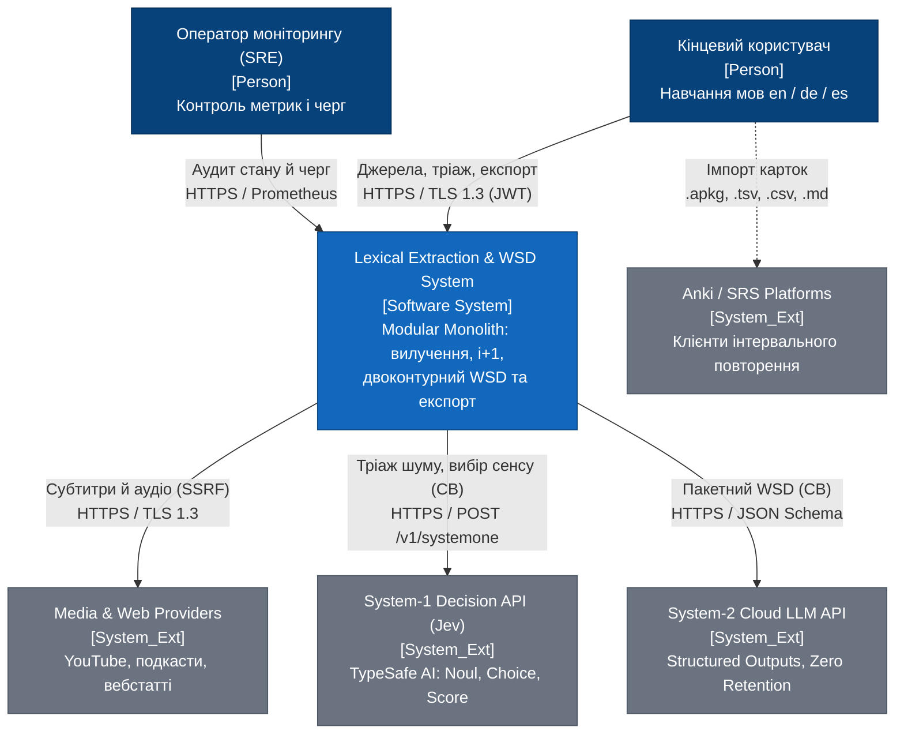
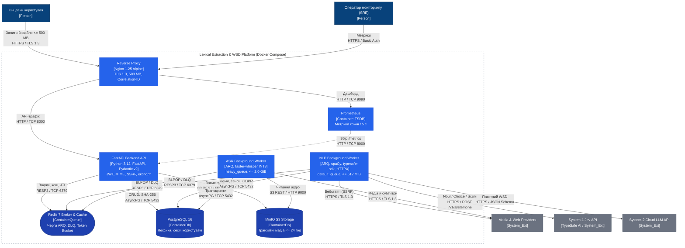

# РОЗДІЛ 2. АРХІТЕКТУРНЕ ПРОЄКТУВАННЯ, МОДЕЛЮВАННЯ ДАНИХ ТА АЛГОРИТМІЗАЦІЯ NLP/AI-КОНВЕЄРА

> **Статус документа:** Розроблено підрозділ `2.1` (модель C4 рівнів 1–3, трасування до [SRS](./srs.md) та [ADR-001](./adr/0001-choice-of-technology.md)). Підрозділи `2.2–2.3` перебувають на наступних етапах календарного плану.

---

## 2.1. Контекстне, контейнерне та компонентне моделювання системи (C4 Model)

Проєктування архітектури виконано за методологією **C4 Model** Саймона Брауна з використанням підходу *Diagrams-as-Code* (`Mermaid.js`) на основі затвердженого контракту вимог [SRS](./srs.md) та архітектурного рішення [ADR-001](./adr/0001-choice-of-technology.md).

---

### 2.1.1. Контекстне та контейнерне моделювання системи (C4 Levels 1–2)

#### Діаграма C4 Level 1 — System Context Diagram

##### Технічний опис вузлів, акторів та протоколів рівня System Context
- **Кінцевий користувач:** взаємодіє із системою за протоколом `HTTPS / TLS 1.3` (`JWT Bearer`), реалізуючи сценарії інгестії ([`SRS-FUN-01`](./srs.md#srs-fun-01), [`SRS-FUN-02`](./srs.md#srs-fun-02)), тріажу та експорту колод ([`SRS-FUN-14`](./srs.md#srs-fun-14)).
- **Оператор моніторингу (`SRE`):** отримує доступ до зібраних метрик і структурованих журналів (`X-Correlation-ID`), реалізуючи вимоги спостережуваності [`SRS-NFR-OBS-01`](./srs.md#srs-nfr-obs-01) та контролю збоїв [`SRS-FUN-13`](./srs.md#srs-fun-13).
- **`Media & Web Providers`:** зовнішні веб- і медіаджерела, звернення до яких виконується через `HTTPS / TLS 1.3` із перевіркою IP-діапазонів (`SSRF Guard`, [`SRS-FUN-01`](./srs.md#srs-fun-01), [`SRS-NFR-SEC-02`](./srs.md#srs-nfr-sec-02)).
- **`System-1 Decision API (Jev)`:** зовнішня хмарна модель прийняття рішень (`TypeSafe AI`, `POST /v1/systemone`, клієнт `typesafe-sdk`), яка без генерації тексту оцінює стан через типізовані примітиви `Noul` (фільтрація артефактів субтитрів), `Choice` (вибір семантичного сенсу й найкращого речення) та `Score` за `70–500 мс` із маскуванням `PII` і захистом `Circuit Breaker` ([`SRS-FUN-10`](./srs.md#srs-fun-10), [`SRS-NFR-REL-01`](./srs.md#srs-nfr-rel-01)).
- **`System-2 Cloud LLM API`:** зовнішній генеративний провайдер пакетної дезамбігуації та перекладу нових термінів через `HTTPS / JSON Schema` із маскуванням `PII` ([`SRS-FUN-11`](./srs.md#srs-fun-11)) і захистом `Circuit Breaker` ([`SRS-NFR-REL-01`](./srs.md#srs-nfr-rel-01)).
- **`Anki / SRS Platforms`:** зовнішні автономні клієнти, у які користувач імпортує сформовані пакети `.apkg`, `.tsv`, `.csv` та `.md` ([`SRS-FUN-14`](./srs.md#srs-fun-14)).

---

#### Діаграма C4 Level 2 — Container Diagram

##### Технічний опис контейнерів та наскрізне трасування до вимог SRS і ADR
1. **`Reverse Proxy` (`Nginx 1.25`):** забезпечує термінацію `HTTPS / TLS 1.3`, обмеження максимального розміру тіла запиту `500 MB`, захист від повільних клієнтів і генерацію наскрізного ідентифікатора `X-Correlation-ID` ([`SRS-NFR-SEC-02`](./srs.md#srs-nfr-sec-02), [`SRS-NFR-OBS-01`](./srs.md#srs-nfr-obs-01)).
2. **`FastAPI Backend API`:** реалізує автентифікацію `JWT Bearer / Argon2id` ([`SRS-NFR-SEC-01`](./srs.md#srs-nfr-sec-01)), прийом `URL` і файлів з перевіркою *magic bytes* та `SSRF` ([`SRS-FUN-01`](./srs.md#srs-fun-01), [`SRS-FUN-02`](./srs.md#srs-fun-02)), ідемпотентну постановку задач ([`SRS-FUN-03`](./srs.md#srs-fun-03), [`SRS-NFR-PERF-02`](./srs.md#srs-nfr-perf-02)) та генерацію файлів експорту ([`SRS-FUN-14`](./srs.md#srs-fun-14)).
3. **`NLP Background Worker` (`nlp_worker`, ліміт `<= 512 MiB`):** фізично відокремлений процес для обслуговування `default_queue`, що виконує локальний розбір `spaCy` (`LRU`-кеш на `1` модель), оцінку `i+1 / CEFR`, відсікання відомих лем у БД, клієнтську інтеграцію зі зовнішніми сервісами `System-1 Jev API` (`typesafe-sdk` / `HTTPX`) і пакетним `System-2 LLM API` ([`SRS-FUN-06`](./srs.md#srs-fun-06)–[`SRS-FUN-12`](./srs.md#srs-fun-12)) та асинхронне очищення профілів за `GDPR` ([`SRS-NFR-COMP-01`](./srs.md#srs-nfr-comp-01)). Вибір ізоляції обґрунтовано в [`ADR-001`](./adr/0001-choice-of-technology.md).
4. **`ASR Background Worker` (`transcribe_worker`, ліміт `<= 2.0 GiB`):** ізольований контейнер для `heavy_transcribe_queue`, що завантажує субтитри/аудіо й виконує локальну транскрибацію через `faster-whisper-small (INT8)` до `120 хв` без фрагментації `25 MB` ([`SRS-FUN-04`](./srs.md#srs-fun-04), [`SRS-FUN-05`](./srs.md#srs-fun-05), [`SRS-NFR-PERF-04`](./srs.md#srs-nfr-perf-04), [`SRS-NFR-INFRA-01`](./srs.md#srs-nfr-infra-01)).
5. **`Redis 7 Broker & Cache`:** виконує роль брокера черг (`default_queue`, `heavy_transcribe_queue`, `default_dlq`, `transcribe_dlq`) за протоколом `RESP3 / TCP (6379)`, кешу ідемпотентності `X-Idempotency-Key`, лічильників `Token Bucket` та чорного списку `JTI` ([`SRS-FUN-03`](./srs.md#srs-fun-03), [`SRS-FUN-13`](./srs.md#srs-fun-13), [`ADR-001`](./adr/0001-choice-of-technology.md)).
6. **`PostgreSQL 16 Database`:** центральне реляційне сховище (`PostgreSQL Wire / AsyncPG`, порт `5432`), що підтримує індексний пошук дублікатів за `SHA-256` ([`SRS-NFR-PERF-03`](./srs.md#srs-nfr-perf-03)) та атомарне збереження `global_lemmas` і `lexical_senses` ([`SRS-FUN-12`](./srs.md#srs-fun-12), [`ADR-001`](./adr/0001-choice-of-technology.md)).
7. **`MinIO Object Storage`:** S3-сумісне транзитне сховище (`S3 REST API / HTTP`, порт `9000`) з політикою автоматичного видалення файлів через `24 год` ([`SRS-FUN-02`](./srs.md#srs-fun-02), [`SRS-NFR-COMP-01`](./srs.md#srs-nfr-comp-01)).
8. **`Prometheus`:** внутрішній сервіс моніторингу, що опитує `/metrics` кожні `15 с` ([`SRS-NFR-OBS-01`](./srs.md#srs-nfr-obs-01)).

---

### 2.1.2. Компонентне моделювання критичного сервісу (C4 Level 3 — Component Diagram)

Для поглибленого проєктування обрано найскладніший серверний контейнер — **`NLP & Semantic Disambiguation Worker (nlp_worker)`**, який поєднує `CPU`-лінгвістику, керування пам'яттю, санітизацію персональних даних і відмовостійку взаємодію з двома зовнішніми хмарними ШІ-сервісами (`System-1 TypeSafe AI / Jev` та `System-2 Cloud LLM API`). Внутрішню структуру побудовано за принципами **Clean Architecture** та **Dependency Inversion (DIP)** через контракти `typing.Protocol`.

#### Діаграма C4 Level 3 — Component Diagram (`NLP & Semantic Disambiguation Worker`)

```mermaid
flowchart TB
    classDef comp fill:#3B82F6,stroke:#1D4ED8,color:#FFFFFF
    classDef port fill:#0EA5E9,stroke:#0369A1,color:#FFFFFF,stroke-dasharray: 5 3
    classDef db fill:#1E40AF,stroke:#1E3A8A,color:#FFFFFF
    classDef ext fill:#6B7280,stroke:#4B5563,color:#FFFFFF

    RedisQ(["Redis 7<br/>[ContainerQueue]<br/>default_queue, default_dlq,<br/>Token Bucket"]):::db

    subgraph Worker["NLP & Semantic Disambiguation Worker (nlp_worker)"]
        direction TB

        subgraph Inbound["1. Вхідний шар (Inbound & Guards)"]
            direction LR
            Consumer["ARQ Task Consumer<br/>[Опитування черги]"]:::comp
            Validator["Task Validator & Tenant Guard<br/>[Pydantic v2, Correlation-ID, user_id]"]:::comp
            ErrHandler["Worker Fault & DLQ Handler<br/>[Статус FAILED + DLQ]"]:::comp
        end

        subgraph AppCore["2. Координація та порти (Application & DIP)"]
            direction LR
            UseCase["ProcessAnalysisPipelineUseCase<br/>[Оркестратор пайплайна]"]:::comp
            Ports["Application Ports<br/>[typing.Protocol]<br/>WebScraper / VocabRepo / SenseRepo /<br/>System1GatePort / LLMProviderPort"]:::port
        end

        subgraph Domain["3. Доменний шар (Domain Core)"]
            direction LR
            LingSvc["Linguistic Analysis<br/>[spaCy LRU <= 1, MWE]"]:::comp
            Profiler["Complexity Profiler<br/>[i+1 / CEFR]"]:::comp
            PIIGuard["PII Sanitizer<br/>[Перед зовнішніми AI API]"]:::comp
            WSDEngine["WSD Strategy Engine<br/>[Каскад S1 -> S2 -> Fallback]"]:::comp
            Heuristic["Local Heuristic Fallback<br/>[Правила речень + WordNet]"]:::comp
        end

        subgraph Outbound["4. Вихідні адаптери (Outbound Adapters)"]
            direction LR
            WebAdapter["Safe Web Scraper<br/>[trafilatura + SSRF Guard]"]:::comp
            JevAdapter["Resilient Jev Adapter<br/>[typesafe-sdk + CB]"]:::comp
            LLMAdapter["Resilient LLM Adapter<br/>[Tenacity + Circuit Breaker]"]:::comp
            PGRepo["PostgreSQL Adapter<br/>[AsyncPG + ON CONFLICT]"]:::comp
        end
    end

    WebExt["External Web Sites<br/>[System_Ext]"]:::ext
    JevExt["System-1 Jev API<br/>[TypeSafe AI / v1/systemone]"]:::ext
    LLMExt["System-2 Cloud LLM API<br/>[System_Ext]"]:::ext
    PG[("PostgreSQL 16<br/>[ContainerDb]")]:::db

    Consumer -->|"BLPOP<br/>RESP3 / TCP"| RedisQ
    Consumer -->|"Сире повідомлення"| Validator
    Consumer -.->|"Після max_tries"| ErrHandler
    ErrHandler -->|"Запис у default_dlq<br/>RESP3 / TCP"| RedisQ
    ErrHandler -->|"FAILED<br/>Protocol DI"| Ports

    Validator -->|"Валідний DTO"| UseCase
    UseCase -->|"Зовнішній I/O<br/>Protocol DI"| Ports
    UseCase --> LingSvc
    UseCase --> Profiler
    UseCase --> PIIGuard
    UseCase --> WSDEngine

    WSDEngine -->|"1-й контур: Noul/Choice<br/>Protocol DI"| Ports
    WSDEngine -->|"2-й контур: LLM WSD<br/>Protocol DI"| Ports
    WSDEngine -.->|"Аварійний резерв"| Heuristic

    WebAdapter -.->|"Implements"| Ports
    JevAdapter -.->|"Implements"| Ports
    LLMAdapter -.->|"Implements"| Ports
    PGRepo -.->|"Implements"| Ports

    WebAdapter -->|"HTML (SSRF Guard)<br/>HTTPS / TLS 1.3"| WebExt
    JevAdapter -->|"Квоти<br/>RESP3 / TCP"| RedisQ
    JevAdapter -->|"Noul, Choice, Score<br/>HTTPS / POST /v1/systemone"| JevExt
    LLMAdapter -->|"Квоти<br/>RESP3 / TCP"| RedisQ
    LLMAdapter -->|"Пакетний запит<br/>HTTPS / JSON Schema"| LLMExt
    PGRepo -->|"Транзакції<br/>AsyncPG / TCP 5432"| PG

    style Worker fill:transparent,stroke:#64748B,stroke-dasharray: 5 5
    style Inbound fill:transparent,stroke:#475569
    style AppCore fill:transparent,stroke:#475569
    style Domain fill:transparent,stroke:#475569
    style Outbound fill:transparent,stroke:#475569
```

##### Деталізований опис внутрішніх компонентів сервісу, патернів і трасування до вимог

1. **Вхідний шар (`Inbound / Framework`):**
   - **`ARQ Task Consumer`:** точка входу фонового процесу, опитує `default_queue` у `Redis 7` (`RESP3 / TCP`), перехоплює винятки через `Worker Fault & DLQ Handler` і забезпечує виконання вимог [`SRS-FUN-03`](./srs.md#srs-fun-03), [`SRS-FUN-13`](./srs.md#srs-fun-13).
   - **`Task Validator & Tenant Guard`:** валідує вхідне повідомлення схемами `Pydantic v2`, встановлює контекст `X-Correlation-ID` ([`SRS-NFR-OBS-01`](./srs.md#srs-nfr-obs-01)) і перевіряє відповідність `user_id` власнику `SourceAnalysisSession` (ізоляція профілів користувачів).
   - **`Worker Fault & DLQ Handler`:** перехоплює критичні помилки обробки, оновлює статус сесії на `FAILED` через порт репозиторію (без прямого зв'язування з ORM) та записує діагностику в `default_dlq` ([`SRS-FUN-13`](./srs.md#srs-fun-13)).

2. **Шар координації (`Application Layer & Ports`):**
   - **`ProcessAnalysisPipelineUseCase`:** центральний оркестратор пайплайна, що ліквідує каскадну зв'язність між доменними сервісами; реалізує патерн **Pipeline / Application Service**.
   - **`Application Ports` (`typing.Protocol`):** реалізує принцип **Dependency Inversion (DIP)** — шар сценаріїв і домену залежить виключно від абстрактних інтерфейсів (`WebScraperPort`, `VocabRepoPort`, `SenseRepoPort`, `System1GatePort`, `LLMProviderPort`), а не від конкретних клієнтів `SQLAlchemy`, `typesafe-sdk` чи `HTTPX`. Залежності ін'єктуються під час старту процесу через `Composition Root`.

3. **Доменний шар (`Domain Layer`):**
   - **`Linguistic Analysis Service`:** виконує локальну токенізацію, лематизацію й виявлення *split phrasal verbs* через `spaCy Dependency Matcher` для `en`, `de`, `es` із `LRU`-кешем (`<= 1` активна модель у `RAM`) — трасування до [`SRS-FUN-06`](./srs.md#srs-fun-06), [`SRS-FUN-07`](./srs.md#srs-fun-07), [`SRS-NFR-INFRA-01`](./srs.md#srs-nfr-infra-01).
   - **`Complexity Profiling Service`:** обчислює метрику *Comprehensible Input (`i+1`)* / `CEFR` ([`SRS-FUN-08`](./srs.md#srs-fun-08)) та відсікає відомі одиниці (`KNOWN`, `IGNORED`) без прямих запитів у БД ([`SRS-FUN-09`](./srs.md#srs-fun-09)).
   - **`PII Sanitizer`:** маскує персональні дані у прикладах речень до передачі в будь-які зовнішні ШІ-сервіси (`System-1 Jev` і `System-2 LLM`) ([`SRS-FUN-11`](./srs.md#srs-fun-11), [`SRS-NFR-COMP-01`](./srs.md#srs-nfr-comp-01)).
   - **`WSD Strategy Engine` + `Local Heuristic Fallback`:** реалізує патерн **Strategy** для каскадної дезамбігуації через інтерфейси `System1GatePort` ([`SRS-FUN-10`](./srs.md#srs-fun-10)) та `LLMProviderPort` ([`SRS-FUN-11`](./srs.md#srs-fun-11)), а при недоступності зовнішніх сервісів (`Circuit Breaker == OPEN`) перемикається на локальний детермінований резерв (`WordNet` + евристика речень).

4. **Вихідний шар інфраструктури (`Outbound Adapters`):**
   - **`Safe Web Scraper Adapter`:** завантажує `HTML`-статті через `trafilatura`, попередньо перевіряючи розв'язану DNS IP-адресу через `SSRF Guard` ([`SRS-FUN-01`](./srs.md#srs-fun-01), [`SRS-FUN-04`](./srs.md#srs-fun-04), [`SRS-NFR-SEC-02`](./srs.md#srs-nfr-sec-02)).
   - **`Resilient Jev Adapter`:** реалізує `System1GatePort`, інтегрується зі зовнішнім `TypeSafe AI API` (`POST /v1/systemone`, бібліотека `typesafe-sdk` або `HTTPX` із ключем `TYPESAFE_API_KEY`) із типізованими примітивами `Noul` (булева фільтрація артефактів), `Choice` (вибір семантичного сенсу та найкращого речення) і `Score` (`70–500 мс`), контролює квоти `Token Bucket` у `Redis 7` та захищений `Circuit Breaker` ([`SRS-FUN-10`](./srs.md#srs-fun-10), [`SRS-NFR-REL-01`](./srs.md#srs-nfr-rel-01)).
   - **`Resilient LLM Adapter`:** реалізує `LLMProviderPort`, перевіряє квоти `Token Bucket` у `Redis 7`, виконує до `3` повторних спроб у межах бюджету `<= 8.0 с` (`Exponential Backoff with Jitter`), а при стані `Circuit Breaker == OPEN` повертає управління `System-1` або локальному резерву за `<= 500 мс` із `degraded_mode=true` ([`SRS-FUN-12`](./srs.md#srs-fun-12), [`SRS-NFR-REL-01`](./srs.md#srs-nfr-rel-01)).
   - **`PostgreSQL Persistence Adapter`:** виконує асинхронні транзакції через `SQLAlchemy 2.0 AsyncPG` із конструкцією `INSERT ... ON CONFLICT DO UPDATE / NOTHING` для підтримки унікальності `(lemma, part_of_speech)` при конкурентному записі ([`SRS-FUN-12`](./srs.md#srs-fun-12), [`ADR-001`](./adr/0001-choice-of-technology.md)).

---

### 2.1.3. Документування архітектурних рішень (`Architecture Decision Records`)

Ключовий інженерний компроміс проєкту — вибір топології **`Modular Monolith` (`FastAPI` + `Redis 7 / ARQ`)** замість розподілених мікросервісів на базі `Apache Kafka` та вбудованих `FastAPI BackgroundTasks` — зафіксовано за шаблоном Майкла Нігардза у документі [**`ADR-001`**](./adr/0001-choice-of-technology.md) (статус: **`Approved`**). Рішення кількісно збалансовує споживання `RAM` (`<= 50 MiB` для `Redis 7` проти `1.5–2.0 GiB` для `Kafka`), транзакційну `ACID`-цілісність словникового ядра, затримку диспетчеризації `p99 <= 25 мс` та чітко документує прийняті ризики (`AOF everysec` вікно `<= 1 с`, відсутність *Event Replay*, конкуренція за з'єднання `PostgreSQL 16` і вертикальна стеля односерверного розгортання).

---

## 2.2. Проєктування реляційної схеми бази даних PostgreSQL та структур оперативного сховища Redis

> *Підрозділ заповнюється на наступному етапі календарного плану (Етап №3).*

- Логічна та фізична ER-діаграма бази даних під керуванням `PostgreSQL 16`.
- Нормалізація зберігання лексичного ядра: розділення глобального словника лем (`global_lemmas`), семантичних значень полісемії (`lexical_senses`) та матриці станів вивчення користувача (`NEW`, `LEARNING`, `KNOWN`, `IGNORED`).
- Організація простору ключів у `Redis 7`: ізольовані черги задач `ARQ`, кеш `X-Idempotency-Key`, лімітер `Token Bucket` та чорний список `JTI`.

---

## 2.3. Алгоритмізація гібридного каскаду вилучення лексичних одиниць і семантичної дезамбігуації

> *Підрозділ заповнюється на етапі алгоритмізації (Етап №4).*

- Кількісна оцінка придатності матеріалу за моделлю *Comprehensible Input (`i+1`)* та морфосинтаксичний аналіз (`spaCy` із детектором `MWE`).
- Багатофакторна математична функція ранжування лем і швидка типізована фільтрація `System-1 (Jev)`.
- Контракти *Structured Outputs* (`Pydantic v2 / JSON Schema`) та алгоритм пакетного звернення до `System-2 (LLM)`.

---

## 2.4. Висновки до розділу 2

> *Підрозділ формується після завершення архітектурного та алгоритмічного проєктування.*
